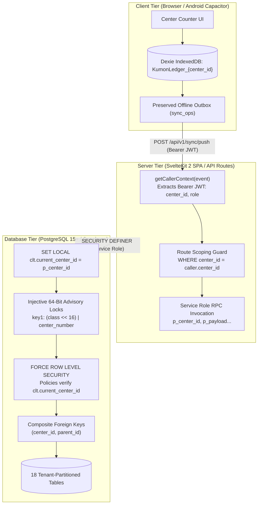

# Multi-Center Row-Level Multi-Tenancy Architecture (V1 Baseline)

* **Author:** Zia / Orchestrator
* **Status:** Approved Technical Design Specification (EGM Phase 2)
* **Date:** 2026-11-08

---

## Overview

BRAC Kumon operates an expanding network of learning centers across Bangladesh (e.g., Mohakhali, Iqbal Road, Rampura, Jamalkhan, Chittagong). Each center operates as an independent franchise business with its own franchise owner, dedicated bank account, dedicated bKash merchant wallet, counter staff, and localized National Board of Revenue (NBR) tax registration.

This design document specifies the architecture, data model, security boundaries, and migration plan required to evolve the Cosmo/Kumon Ledger Track application from a single-business tool into an enterprise-grade **Platform Multi-Tenant Ledger**. Multiple franchise centers will operate within a single shared PostgreSQL database and application cluster, enforced by strict row-level security (`center_id`), center-scoped advisory locks, per-center human-readable IDs, token-derived tenant authentication, and a Platform Super-Admin audit tier.

---

## The Problem

The existing Cosmo Ledger Track codebase and implementation plans (001–022) were built under a strict single-tenant model:
1. **Global Uniqueness Constraints:** Hard database invariants assume only one business exists in the database (e.g., `uq_one_owner` restricts the database to one owner, `payment_methods.code` is globally unique, and `month_closes` primary key is `(month)`).
2. **Global Financial Triggers:** Database triggers such as `fn_entries_recalc_settlements()` recalculate liabilities and invalidate statement reconciliations across all entries globally regardless of branch.
3. **Advisory Lock Serialization:** Concurrency control locks months globally using `(1001, year*12 + month)`. If one center closes a month, all other centers in Bangladesh are blocked from sync mutations.
4. **Competitive Intelligence Leaks:** Global sequential entry numbering (`E-YYYYMM-XXXXXX`) allows competing franchise owners to deduce national transaction volume and growth velocity by monitoring sequential jumps.
5. **Offline Counter Shift-Handover Risk:** Counter tablets are shared by staff across shifts. Erasing local device storage on sign-out destroys un-synced offline tuition payments recorded during internet disruptions.

Without row-level multi-tenancy, serving Kumon centers requires deploying and maintaining dozens of distinct cloud databases and application instances, creating unsustainable operational overhead and preventing franchisor-level audit oversight.

---

## Goals

1. **Strict Relational Tenant Isolation:** Guarantee that Center A staff and administrators can never read, modify, match, or reconcile Center B's ledger entries, bank statements, or settlement liabilities.
2. **`service_role` Parameter Security Contract:** Enforce `ALTER TABLE ... FORCE ROW LEVEL SECURITY` across all 18 tables, and require SvelteKit API routes to verify JWT claims and explicitly inject tenant context (`SET LOCAL clt.current_center_id = p_center_id`) into every `SECURITY DEFINER` RPC.
3. **Zero-Collision Advisory Locks:** Implement a 64-bit injective coordinate lock scheme that guarantees 0.000000% lock collision probability between centers.
4. **Shift-Safe Offline Storage:** Scope local IndexedDB databases per center (`KumonLedger_${center_id}`) and preserve pending offline `sync_ops` during staff sign-out or session expiration.
5. **Competitive Privacy Protection:** Generate human-readable entry IDs with center-specific codes and independent counters (`E-{CENTER_CODE}-YYYYMM-XXXXXX`).
6. **Platform Super-Admin Governance:** Provide BRAC Kumon head office with a read-only audit oversight portal ("God Mode" for auditing and dispute resolution) and an atomic center onboarding RPC (`rpc_create_center`).
7. **Clean Declarative Baseline:** Execute a clean rewrite of baseline database migrations (001–006) for V1 rather than accumulating schema debt through additive pre-production patches.
8. **Pure Calculation Engine:** Keep `packages/calc` 100% pure, mathematical, and tenant-agnostic.

---

## Non-Goals

1. **Inter-Center Financial Transfers:** The system will not process internal balance transfers or student credit transfers between branches.
2. **Aggregated Merchant Wallets:** Centers will not share bank accounts or bKash merchant wallets. Each center reconciles its own merchant statements.
3. **Double-Entry General Ledger / ERP:** The app remains an offline-first payment capture and settlement ledger, not a full enterprise resource planning system.
4. **Public Self-Service Sign-Up:** New centers and center owners cannot self-register online; onboarding is strictly initiated by Platform Super-Admins.
5. **Cross-Center User Accounts:** A user email is strictly 1:1 with a single center. Staff working at multiple branches must use distinct email aliases.

---

## Open Questions

*   **Question 1 (Rate Profile Governance):** Should the Platform Super-Admin be able to publish mandatory "Corporate Template" rate profiles (e.g. standard 42% Kumon royalty fee) that Center Admins cannot alter, or do centers retain 100% autonomy over their rate definitions?
*   **Question 2 (Center Deactivation Retention):** When a center is marked `suspended`, should offline transactions uploaded by that center be permanently rejected, or held in a quarantine table for supervisor review?

---

## Technical Plan

### 1. Architectural Overview & Request Flow

The system maintains a multi-layer isolation boundary between client devices, SvelteKit application servers, and PostgreSQL persistence:



---

### 2. Data Model & Schema Specification

#### 2.1 The `centers` Entity
Every center represents an autonomous legal franchise entity registered with Kumon Bangladesh and the NBR:

```sql
CREATE TABLE centers (
  id UUID PRIMARY KEY DEFAULT gen_random_uuid(),
  center_number INT GENERATED ALWAYS AS IDENTITY UNIQUE,
  code VARCHAR(8) NOT NULL UNIQUE CHECK (code ~ '^[A-Z0-9]{2,8}$'),
  name TEXT NOT NULL,
  legal_entity_name TEXT NOT NULL,
  bin_number VARCHAR(16),
  trade_license_number VARCHAR(32),
  vat_circle TEXT,
  address TEXT NOT NULL,
  phone VARCHAR(20) NOT NULL,
  status TEXT NOT NULL DEFAULT 'active' CHECK (status IN ('active', 'suspended', 'archived')),
  created_at TIMESTAMPTZ NOT NULL DEFAULT now()
);

-- Immutable Code Trigger (Prevents breaking human-readable ID prefixes)
CREATE OR REPLACE FUNCTION fn_centers_prevent_code_mutation()
RETURNS TRIGGER AS $$
BEGIN
  IF NEW.code <> OLD.code THEN
    RAISE EXCEPTION 'centers.code is immutable once provisioned';
  END IF;
  RETURN NEW;
END;
$$ LANGUAGE plpgsql;

CREATE TRIGGER trg_centers_immutable_code
BEFORE UPDATE ON centers
FOR EACH ROW EXECUTE FUNCTION fn_centers_prevent_code_mutation();
```

#### 2.2 Table-by-Table Tenancy Partitioning
All 18 core tables are updated to declare `center_id UUID NOT NULL REFERENCES centers(id) ON DELETE RESTRICT` (with the single exception of `profiles` and `audit_log` where `super_admin` platform rows permit `NULL`):

| Table | `center_id` Type | Composite Keys / Unique Constraints | Foreign Key Dependencies |
|---|---|---|---|
| `centers` | Primary Key (`id`) | `UNIQUE(code)`, `UNIQUE(center_number)` | Root entity |
| `profiles` | `UUID NULL` (NULL for `super_admin`) | `UNIQUE(center_id) WHERE role = 'owner' AND active = true` | `REFERENCES centers(id)` |
| `payment_methods` | `UUID NOT NULL` | `UNIQUE(center_id, id)`, `UNIQUE(center_id, code)` | `REFERENCES centers(id)` |
| `payables` | `UUID NOT NULL` | `UNIQUE(center_id, id)`, `UNIQUE(center_id, code)`, `UNIQUE(center_id, kind) WHERE kind = 'vat' AND active = true` | `REFERENCES centers(id)` |
| `rate_profiles` | `UUID NOT NULL` | `UNIQUE(center_id, id)`, `UNIQUE(center_id, version) WHERE status = 'published'`, `EXCLUDE USING gist (center_id WITH =, ...)` | `REFERENCES centers(id)` |
| `method_rates` | `UUID NOT NULL` | `PRIMARY KEY (rate_profile_id, method_id)` | Composite FKs to `rate_profiles(center_id, id)` and `payment_methods(center_id, id)` |
| `entries` | `UUID NOT NULL` | `UNIQUE(center_id, id)`, `UNIQUE(center_id, entry_number)` | Composite FKs to methods, profiles, and rate_profiles |
| `entry_reconciliation_exceptions` | `UUID NOT NULL` | `PRIMARY KEY (center_id, entry_id, payable_id)` | Composite FKs to `entries(center_id, id)` and `payables(center_id, id)` |
| `settlements` | `UUID NOT NULL` | `UNIQUE(center_id, id)`, `UNIQUE(center_id, payable_id, month)` | Composite FKs to `payables(center_id, id)` |
| `settlement_payments` | `UUID NOT NULL` | `UNIQUE(center_id, id)` | Composite FKs to `settlements(center_id, id)` |
| `statements` | `UUID NOT NULL` | `UNIQUE(center_id, id)` | `REFERENCES centers(id)` |
| `statement_payables` | `UUID NOT NULL` | `PRIMARY KEY (statement_id, payable_id)` | Composite FKs to `statements(center_id, id)` and `payables(center_id, id)` |
| `statement_lines` | `UUID NOT NULL` | `UNIQUE(center_id, id)`, `UNIQUE(statement_id, line_index)` | Composite FKs to `statements(center_id, id)` and `entries(center_id, id)` |
| `month_closes` | `UUID NOT NULL` | `PRIMARY KEY (center_id, month)` | `REFERENCES centers(id)` |
| `month_close_events` | `UUID NOT NULL` | `PRIMARY KEY (id)` | Composite FK to `month_closes(center_id, month)` |
| `sync_ops` | `UUID NOT NULL` | `UNIQUE(center_id, op_id)` | `REFERENCES centers(id)` |
| `devices` | `UUID NOT NULL` | `UNIQUE(center_id, device_id, user_id)` | Composite FK to `profiles(center_id, id)` |
| `app_settings` | `UUID NOT NULL PRIMARY KEY` | `PRIMARY KEY (center_id)` | `REFERENCES centers(id) ON DELETE CASCADE` |
| `audit_log` | `UUID NULL` (NULL for platform events) | Range-partitioned by `created_at` (monthly) | `REFERENCES centers(id)` |

---

### 3. Concurrency & Injective Advisory Lock Formula

To eliminate the integer overflow and cross-center collision bugs of 32-bit arithmetic hashing, concurrency locks use a **two-coordinate injective scheme** mapping into PostgreSQL `pg_advisory_xact_lock(int4, int4)`:

* **Coordinate 1 (`key1`): Lock Class & Center Identity:**
  $$\text{key1} = (\text{class\_id} \ll 16) \mid (\text{center\_number} \ \& \ \text{0xFFFF})$$
  *(Where `class_id` is 1001 for Month Lock, 1002 for Sequence Lock, 1003 for Rate Lock).*
* **Coordinate 2 (`key2`): Domain Target:**
  * **Class 1001 (Month Lock):** $\text{key2} = \text{year} \times 12 + \text{month}$
  * **Class 1002 (Sequence Lock):** $\text{key2} = 1$
  * **Class 1003 (Rate Lock):** $\text{key2} = 1$

```sql
CREATE OR REPLACE FUNCTION fn_lock_month(p_center_number INT, p_year INT, p_month INT)
RETURNS VOID AS $$
BEGIN
  PERFORM pg_advisory_xact_lock(
    (1001 << 16) | (p_center_number & 65535),
    (p_year * 12 + p_month)
  );
END;
$$ LANGUAGE plpgsql;
```

---

### 4. SvelteKit Server Mediation & RLS Parameter Contract

1. **`FORCE ROW LEVEL SECURITY`**:
   Executed across all 18 tables:
   ```sql
   ALTER TABLE entries FORCE ROW LEVEL SECURITY;
   ```
2. **Context Injection in RPCs**:
   Every `SECURITY DEFINER` mutation RPC receives `p_center_id UUID` as its first verified argument. The RPC immediately sets a transaction-local session configuration:
   ```sql
   PERFORM set_config('clt.current_center_id', p_center_id::text, true);
   ```
3. **RLS Policy Predicate**:
   ```sql
   CREATE POLICY "entries_tenant_isolation" ON entries
   FOR ALL TO authenticated
   USING (
     center_id = COALESCE(
       NULLIF(current_setting('clt.current_center_id', true), '')::uuid,
       (auth.jwt() -> 'app_metadata' ->> 'center_id')::uuid
     )
     OR (auth.jwt() -> 'app_metadata' ->> 'role') = 'super_admin'
   );
   ```
4. **Server Route Mediation**:
   In `apps/web/src/routes/api/v1/sync/pull/+server.ts` and `admin/audit/+server.ts`:
   * All queries executed via `service_role` explicitly append `AND center_id = caller.centerId`.
   * For Super-Admin requests, the filter is optionally omitted if a center query parameter is not supplied.

---

### 5. Atomic Day-Zero Center Provisioning (`rpc_create_center`)

New centers are provisioned atomically by Platform Super-Admin:

```sql
CREATE OR REPLACE FUNCTION rpc_create_center(
  p_code VARCHAR(8),
  p_name TEXT,
  p_legal_entity_name TEXT,
  p_bin_number VARCHAR(16),
  p_trade_license VARCHAR(32),
  p_address TEXT,
  p_phone VARCHAR(20),
  p_owner_email TEXT,
  p_owner_name TEXT
) RETURNS JSONB AS $$
DECLARE
  v_center_id UUID;
  v_owner_id UUID;
  v_rate_profile_id UUID;
  v_cash_id UUID;
  v_bkash_id UUID;
  v_visa_id UUID;
  v_master_id UUID;
  v_vat_payable_id UUID;
  v_bkash_payable_id UUID;
  v_card_payable_id UUID;
BEGIN
  -- 1. Create Center Record
  INSERT INTO centers (code, name, legal_entity_name, bin_number, trade_license_number, address, phone)
  VALUES (UPPER(p_code), p_name, p_legal_entity_name, p_bin_number, p_trade_license, p_address, p_phone)
  RETURNING id INTO v_center_id;

  -- 2. Seed Default Payment Methods
  INSERT INTO payment_methods (center_id, name, code, requires_txn_ref)
  VALUES 
    (v_center_id, 'Cash', 'cash', false) RETURNING id INTO v_cash_id,
    (v_center_id, 'bKash Merchant', 'bkash', true) RETURNING id INTO v_bkash_id,
    (v_center_id, 'Visa Card', 'visa', true) RETURNING id INTO v_visa_id,
    (v_center_id, 'Mastercard', 'mastercard', true) RETURNING id INTO v_master_id;

  -- 3. Seed Default Payables
  INSERT INTO payables (center_id, name, code, kind, monthly_due_day)
  VALUES
    (v_center_id, 'Government VAT', 'vat', 'vat', 15) RETURNING id INTO v_vat_payable_id,
    (v_center_id, 'bKash Merchant Charges', 'bkash_charge', 'method_charge', 10) RETURNING id INTO v_bkash_payable_id,
    (v_center_id, 'Card Processing Charges', 'card_charge', 'method_charge', 10) RETURNING id INTO v_card_payable_id;

  -- 4. Seed & Publish Baseline Rate Profile v1 (42% Kumon Royalty, 0% VAT baseline)
  INSERT INTO rate_profiles (center_id, version, status, effective_from, vat_mode, vat_bp, commission_bp, commission_base)
  VALUES (v_center_id, 1, 'published', '2026-01-01', 'manual', 0, 4200, 'gross')
  RETURNING id INTO v_rate_profile_id;

  INSERT INTO method_rates (rate_profile_id, method_id, charge_bp, charges_borne_by)
  VALUES
    (v_rate_profile_id, v_cash_id, 0, 'merchant'),
    (v_rate_profile_id, v_bkash_id, 115, 'merchant'),
    (v_rate_profile_id, v_visa_id, 150, 'merchant'),
    (v_rate_profile_id, v_master_id, 150, 'merchant');

  -- 5. Seed Default Center Settings
  INSERT INTO app_settings (center_id, tolerance_poisha, default_due_day)
  VALUES (v_center_id, 100, 15);

  -- 6. Initialize Center Entry Counter
  INSERT INTO center_counters (center_id, next_entry_number)
  VALUES (v_center_id, 1);

  RETURN jsonb_build_object(
    'center_id', v_center_id,
    'code', UPPER(p_code),
    'owner_email', p_owner_email
  );
END;
$$ LANGUAGE plpgsql SECURITY DEFINER;
```

---

### 6. Client Storage & Shift-Handover Outbox Protection

To prevent loss of tuition payments recorded offline when cashiers change shifts:
1. **Dynamic Database Scoping**: Dexie databases are named per center: `KumonLedger_${center_id}`.
2. **Session Sign-Out Protocol**:
   - `session.signOut()` queries `db.sync_ops.count()`.
   - If pending ops > 0: UI warns the cashier: *"15 payments pending sync. Keep tablet connected to finish upload before signing out."*
   - Decrypted view caches (`db.entries`, `db.statements`) can be purged, but **`db.sync_ops` is never deleted** on logout.
   - When the evening receptionist logs in at the same center, the shared database `KumonLedger_${center_id}` automatically resumes syncing the morning shift's pending outbox.

---

### 7. Per-Center Sequential Numbering

* **Format**: `E-{CENTER_CODE}-YYYYMM-XXXXXX` (e.g. `E-MHK-202611-000042`).
* **Counter Mechanism**: Backed by `center_counters (center_id UUID PRIMARY KEY, next_entry_number BIGINT NOT NULL)`.
* **Atomic Generation**: Executed inside `rpc_push_sync_op` under Sequence Lock `(1002, center_number)`:
  ```sql
  UPDATE center_counters 
  SET next_entry_number = next_entry_number + 1
  WHERE center_id = p_center_id
  RETURNING next_entry_number - 1 INTO v_seq;

  v_human_id := 'E-' || v_center_code || '-' || to_char(v_entry_date, 'YYYYMM') || '-' || lpad(v_seq::text, 6, '0');
  ```

---

## Alternatives Considered

### 1. Instance-per-Center (Database-per-Tenant)
* **What it is:** Deploy an isolated Supabase project and PostgreSQL database for each Kumon franchise center.
* **Pros:** Absolute physical isolation, zero risk of cross-tenant data bleed, independent PITR backups, zero RLS query overhead.
* **Cons:** Massive operational overhead (deploying, migrating, and monitoring 30+ independent Supabase databases, API keys, and connection pools). Prohibitive cloud infrastructure costs. Prevents building a unified Platform Super-Admin audit dashboard without complex federated query layers.
* **Reason for Rejection:** Explicitly rejected by Owner in favor of row-level multi-tenancy.

### 2. Schema-per-Center (PostgreSQL Schemas)
* **What it is:** A single PostgreSQL instance with an isolated schema per center (`center_mhk.*`, `center_ram.*`).
* **Pros:** Clean relational boundaries, shared database connection pool.
* **Cons:** Running dynamic DDL schema migrations across dozens of schemas introduces severe maintenance risk. Connection poolers (Supavisor/PgBouncer) face search-path state management complexity. Cross-center aggregations for Platform Super-Admin become cumbersome multi-schema unions.
* **Reason for Rejection:** High migration and pooler operational complexity; row-level security is simpler to maintain declaratively.

### 3. Inherited Tenancy for Child Tables
* **What it is:** Only root tables (`statements`, `entries`) carry `center_id`. Child tables (`statement_lines`, `statement_payables`, `entry_reconciliation_exceptions`) determine tenant context dynamically by joining to the parent table.
* **Pros:** Saves one column on child tables.
* **Cons:** Severe RLS performance degradation (forces PostgreSQL to execute correlated semi-joins/subplans per child row during reconciliation file scans). Furthermore, single-column foreign keys permit cross-tenant injection bugs (e.g., Center A statement line matching a Center B ledger entry).
* **Reason for Rejection:** Rejected on performance and data security grounds. Child tables must carry `center_id` directly, protected by composite foreign keys `(center_id, parent_id)`.

### 4. Naive 32-Bit Arithmetic Advisory Lock Hashing
* **What it is:** `pg_advisory_xact_lock(1001, hash(center_id) + year*12 + month)`.
* **Pros:** Trivial to write.
* **Cons:** Signed `int4` overflow crashes in Postgres. Sliding-window hash collisions across months: whenever $\text{hash}(A) - \text{hash}(B) = \text{Month}_B - \text{Month}_A$, unrelated centers acquire the exact same lock key and block each other during peak fee collection.
* **Reason for Rejection:** Mathematically defective; replaced by the two-coordinate injective bit-packing scheme using `center_number`.

### 5. Full Local Cache Wipe on Shift Handover / Logout
* **What it is:** Invoking `Dexie.delete()` upon every user sign-out to remove all local browser storage.
* **Pros:** Guarantees zero local data residue.
* **Cons:** Erases un-synced offline tuition payments when cashiers change shifts on counter tablets during Dhaka internet outages, violating Hard Rule 6 ("Never block a Save on connectivity") and destroying financial records.
* **Reason for Rejection:** Catastrophic data loss risk; replaced by center-scoped Dexie databases preserving the pending `sync_ops` queue.

---

## Detailed Implementation Plan

This section provides a complete, unified implementation roadmap for transitioning the repository to the Platform Multi-Tenant Ledger. Every file touched, created, or deleted is enumerated with its precise rationale.

### 1. Phased Execution Roadmap

The implementation is structured into 6 sequential phases to maintain verification gates at each step:

```
Phase 1: Database Baseline ──► Phase 2: Shared Types ──► Phase 3: Server Mediation
                                                                   │
Phase 6: Multi-Tenant QA  ◄── Phase 5: Client & Dexie  ◄── Phase 4: Admin & Onboarding
```

*   **Phase 1 (Database DDL & Routines):** Rewrite Migrations 001–006 cleanly. Introduce `centers` table, add `center_id` across all 18 tables, establish composite foreign keys, implement 64-bit injective advisory locks, and scope triggers.
*   **Phase 2 (Shared Contracts & Types):** Update `@clt/shared` models, wire DTOs, Zod validators, and regex to incorporate `center_id`, `super_admin`, and center-prefixed entry IDs (`E-{CODE}-YYYYMM-XXXXXX`).
*   **Phase 3 (Server Mediation & Auth Layer):** Refactor `getCallerContext` in SvelteKit to extract `center_id` and `role` from Bearer JWTs, inject `SET LOCAL clt.current_center_id` into all RPC calls, and enforce tenant scoping on sync and audit routes.
*   **Phase 4 (Super-Admin & Center Onboarding):** Author `rpc_create_center`, build Platform Super-Admin center lifecycle screens (`/admin/super/centers`), and implement global transaction dispute search (`/admin/super/search`).
*   **Phase 5 (Client Storage & Entry Capture):** Scope Dexie IndexedDB instances per center (`KumonLedger_${center_id}`), update `session.signOut()` to preserve the pending `sync_ops` queue, and update the entry capture UI.
*   **Phase 6 (Testing & Zero-Bleed Certification):** Update `scripts/bootstrap.ts` to provision a dual-center test environment (Mohakhali + Rampura), update the 65 mandatory regression tests, and author the new 5-point Suite 6 multi-tenant isolation suite.

---

### 2. Comprehensive File Inventory & Rationales

#### A. Database Migrations & SQL Routines (`supabase/migrations/`)

1.  **`supabase/migrations/20261029000001_core_schema.sql`** *(Rewrite)*
    *   *What:* Creates `centers` table (`id`, `center_number INT IDENTITY`, `code VARCHAR(8) UNIQUE`, legal entity metadata). Adds `center_id UUID NOT NULL REFERENCES centers(id)` to `profiles`, `payment_methods`, `payables`, `rate_profiles`, and `method_rates`. Refactors `uq_one_owner` to `UNIQUE(center_id) WHERE role = 'owner' AND active = true`. Replaces single-tenant uniques with composite `(center_id, code)` constraints. Enables `FORCE ROW LEVEL SECURITY`.
    *   *Why:* Establishes root tenant registry and foundational multi-tenant entity integrity.
2.  **`supabase/migrations/20261029000002_settlements_and_statements.sql`** *(Rewrite)*
    *   *What:* Adds `center_id` to `entries`, `entry_reconciliation_exceptions`, `settlements`, `settlement_payments`, `statements`, `statement_payables`, `statement_lines`, `month_closes`, `month_close_events`, `sync_ops`, `devices`, and `app_settings`. Establishes composite foreign keys `(center_id, parent_id)` on all child tables. Range-partitions `audit_log` by month with `center_id UUID NULL`.
    *   *Why:* Prevents relational cross-matching between centers and eliminates RLS N+1 semi-join performance bottlenecks.
3.  **`supabase/migrations/20261029000003_rls_policies.sql`** *(Rewrite)*
    *   *What:* Replaces single-tenant RLS policies across all 18 tables with predicates verifying `center_id = COALESCE(NULLIF(current_setting('clt.current_center_id', true), '')::uuid, (auth.jwt() -> 'app_metadata' ->> 'center_id')::uuid)` with read bypass for `super_admin`.
    *   *Why:* Enforces strict cryptographic tenant fences at the Postgres storage layer.
4.  **`supabase/migrations/20261029000004_functions_entries_rates_sync.sql`** *(Rewrite)*
    *   *What:* Updates `rpc_push_sync_op` to accept `p_center_id`, lock sequence using 64-bit injective formula `(1002 << 16) | center_number`, generate center-prefixed ID `E-{CODE}-YYYYMM-XXXXXX`, and scope rate validation. Updates `log_audit_event` to accept `p_center_id`.
    *   *Why:* Prevents cross-center sync interference and competitive intelligence volume leaks.
5.  **`supabase/migrations/20261029000005_functions_settlement_recon_month.sql`** *(Rewrite)*
    *   *What:* Scopes `generate_monthly_settlements`, `record_settlement_payment`, `close_month`, `reopen_month`, and statement matching to `p_center_id`. Re-scopes trigger `fn_entries_recalc_settlements()` to `WHERE center_id = NEW.center_id`. Implements 64-bit month locking: `(1001 << 16) | center_number`.
    *   *Why:* Eliminates cross-center statement invalidation cascades and month-close deadlocks.
6.  **`supabase/migrations/20261029000006_center_provisioning.sql`** *(Create)*
    *   *What:* Authors `rpc_create_center` procedure executing atomic creation of center, payment methods, payables, Rate Profile v1, settings, counter, and owner invite.
    *   *Why:* Eliminates manual onboarding errors and ensures all new franchise centers start in a functional state.

#### B. Shared TypeScript Package (`packages/shared/`)

7.  **`packages/shared/src/types.ts`** *(Modify)*
    *   *What:* Adds `centerId: string` to `EntryDto`, `OutboxOpDto`, `SettlementDto`, `StatementDto`, `PayableDto`, and `RateProfileDto`. Adds `'super_admin'` to `UserRole` union (`'super_admin' | 'owner' | 'admin' | 'staff'`). Defines `CenterDto` interface.
    *   *Why:* Aligns core data transfer objects across client, server, and testing packages.
8.  **`packages/shared/src/wire.ts`** *(Modify)*
    *   *What:* Updates Zod schemas (`entryDtoSchema`, `outboxOpSchema`, `createEntrySchema`) to validate `centerId`. Updates human-readable entry ID regex: `/^E-[A-Z0-9]{2,8}-\d{6}-\d{6}$/`.
    *   *Why:* Validates tenant context and new identifier format at process boundaries.

#### C. SvelteKit Server Mediation (`apps/web/src/routes/api/v1/`)

9.  **`apps/web/src/lib/server/auth.ts`** *(Modify)*
    *   *What:* Updates `getCallerContext` to extract `center_id` and `role` from JWT `app_metadata`. Adds helper `assertCallerInCenter(caller, targetCenterId)`. Adds `isSuperAdmin(caller)` helper.
    *   *Why:* Centralizes tenant validation and authorization across all API routes.
10. **`apps/web/src/routes/api/v1/sync/push/+server.ts`** *(Modify)*
    *   *What:* Injects verified `caller.centerId` into `rpc_push_sync_op` payload; rejects payloads attempting to push ops for a different `center_id` with `403 forbidden_tenant_mismatch`.
    *   *Why:* Prevents IDOR attacks on sync pushes.
11. **`apps/web/src/routes/api/v1/sync/pull/+server.ts`** *(Modify)*
    *   *What:* Appends `WHERE center_id = caller.centerId` to all pull queries (`entries`, `rates`, `methods`, `settlements`, `statements`).
    *   *Why:* Plugs the cross-tenant data leak occurring under `service_role`.
12. **`apps/web/src/routes/api/v1/admin/audit/+server.ts`** *(Modify)*
    *   *What:* Restricts audit log queries to `center_id = caller.centerId` (unless caller is `super_admin` with no center filter).
    *   *Why:* Prevents Center A administrators from reading Center B's audit events.
13. **`apps/web/src/routes/api/v1/admin/super/centers/+server.ts`** *(Create)*
    *   *What:* POST endpoint mediating `rpc_create_center` for Platform Super-Admin. GET endpoint listing all franchise centers with health status.
    *   *Why:* Delivers center lifecycle management API.
14. **`apps/web/src/routes/api/v1/admin/super/search/+server.ts`** *(Create)*
    *   *What:* GET endpoint searching `entries` globally by `txn_ref` or customer name for Super-Admin.
    *   *Why:* Enables cross-center customer support and misdirected payment resolution.
15. **`apps/web/src/hooks.server.ts`** *(Modify)*
    *   *What:* Adds request-correlation middleware generating `x-request-id` and logging `{ requestId, centerId, userId, method, path, status, durationMs }`.
    *   *Why:* Enables distributed tracing and telemetry across concurrent multi-center writes.

#### D. Client Application & Offline Engine (`apps/web/src/`)

16. **`apps/web/src/lib/db/index.ts`** *(Modify)*
    *   *What:* Replaces static database `CosmoLedgerTrackDB` with dynamic center factory `getCenterDb(centerId: string): Dexie`. Configures compound primary keys on local stores.
    *   *Why:* Isolates IndexedDB storage per franchise center on disk.
17. **`apps/web/src/lib/auth/session.svelte.ts`** *(Modify)*
    *   *What:* Updates `signOut()` to check `db.sync_ops.count()`. Warns if outbox is non-empty. Purges decrypted view caches while strictly preserving the pending `sync_ops` store.
    *   *Why:* Prevents loss of counter tuition payments during staff shift rotations while offline.
18. **`apps/web/src/routes/(app)/+layout.svelte`** *(Modify)*
    *   *What:* Displays active Center Code badge in the navigation header. Renders Super-Admin center switcher when `userRole === 'super_admin'`.
    *   *Why:* Provides clear visual tenant context and Super-Admin navigation ergonomics.
19. **`apps/web/src/routes/(app)/admin/super/centers/+page.svelte`** *(Create)*
    *   *What:* Super-Admin UI for provisioning new centers, managing franchise statuses (`active`, `suspended`, `archived`), and tracking center metrics.
    *   *Why:* Delivers center governance dashboard.
20. **`apps/web/src/routes/(app)/entries/new/+page.svelte`** *(Modify)*
    *   *What:* Formats entry preview badge to `E-{CENTER_CODE}-YYYYMM-XXXXXX` using active center profile.
    *   *Why:* Displays center-specific numbering to reception staff.

#### E. Test Harness, Fixtures & Scripts (`tests/`, `scripts/`)

21. **`scripts/bootstrap.ts`** *(Modify)*
    *   *What:* In non-production, seeds Platform Super-Admin, Center 1 (Mohakhali, code `MHK`, owner `owner@cosmoledger.local`), and Center 2 (Rampura, code `RMP`, owner `owner-rmp@cosmoledger.local`) with complete independent methods, payables, and published rate profiles.
    *   *Why:* Provisions deterministic multi-center baseline for development and automated testing while preserving existing E2E test account compatibility.
22. **`tests/db/helpers/test-db.ts`** *(Modify)*
    *   *What:* Updates test database provisioner to inject a default test center (`TEST_CENTER_ID`) into all helper seeds.
    *   *Why:* Prevents breaking existing unit and database tests that expect default test fixtures.
23. **`apps/web/tests/regression/suite.test.ts`** *(Modify)*
    *   *What:* Updates all 65 existing regression tests to include `center_id`. Authors new **Suite 6: Multi-Tenant Isolation & Zero Data Bleed** containing 5 tests (RLS isolation, cross-tenant mutation rejection, advisory lock concurrency, sequence monotonicity, Dexie cache separation).
    *   *Why:* Provides verifiable proof of zero cross-tenant data bleed.
24. **`scripts/ops/tenant-backup-restore.ts`** *(Create)*
    *   *What:* CLI script exporting and restoring a single center's complete transaction graph using logical JSON/SQL dumps.
    *   *Why:* Solves the disaster-recovery blast radius problem of global Supabase PITR.

